<!-- ══════════════════════════════════════════════════════════════════════
     armanxploits // readme-04-metro
     A profile drawn as a metro system:
       1 Build · 2 Server · 3 Data · 4 Ship · 5 Security (the circle line)
     Drawings:     assets/metro/   (scripts/build_metro_assets.py)
     Live boards:  output-metro branch, redrawn every 12h from GitHub data
                   (scripts/build_metro_stats.py, .github/workflows/main.yml)
     ══════════════════════════════════════════════════════════════════════ -->

  <a href="https://www.arman-portfolio.online/"></a>

  <a href="#network-map"></a>
  <a href="#ticket-office"></a>
  <a href="#line-diagram"></a>
  <a href="#live-boards"></a>

I'm **Arman**, a B.Tech CSE student (class of 2027) at Silicon Institute of Technology, Bhubaneswar, and a **Cybersecurity Intern** working on pentesting and web application security. I build full-stack products, then review them the way an attacker would, so what ships is the hardened version.


  


  <a href="https://network-packet-analyzer-tan.vercel.app"></a> <a href="https://fsociety-web.vercel.app"></a>
   source: <a href="https://github.com/arman080325/Network-packet-analyzer"><code>Network-packet-analyzer</code></a> &nbsp;·&nbsp; <a href="https://github.com/arman080325/fsociety-web"><code>fsociety-web</code></a>

  <a href="https://banking-management-system-java.onrender.com"></a> <a href="https://student-management-system-java-springboot.onrender.com"></a>
   source: <a href="https://github.com/arman080325/Banking-Management-System-Java"><code>Banking-Management-System-Java</code></a> &nbsp;·&nbsp; <a href="https://github.com/arman080325/Student-Management-System-Java-Springboot"><code>Student-Management-System-Java-Springboot</code></a>

  <a href="https://snapurl-project.vercel.app"></a> <a href="https://cineroulette-web-nu.vercel.app"></a>
   source: <a href="https://github.com/arman080325/SnapURL-Project"><code>SnapURL-Project</code></a> &nbsp;·&nbsp; <a href="https://github.com/arman080325/cineroulette"><code>cineroulette</code></a>

  <a href="https://git-atlas-project.vercel.app"></a> <a href="https://arman080325.github.io/GrabMedia-Project/"></a>
   source: <a href="https://github.com/arman080325/GitAtlas-Project"><code>GitAtlas-Project</code></a> &nbsp;·&nbsp; <a href="https://github.com/arman080325/GrabMedia-Project"><code>GrabMedia-Project</code></a>

  <a href="https://disease-prediction-updated.vercel.app"></a> <a href="https://github.com/arman080325/SiteShield-Web"></a>
   source: <a href="https://github.com/arman080325/Disease-Prediction-Updated"><code>Disease-Prediction-Updated</code></a> &nbsp;·&nbsp; <a href="https://github.com/arman080325/SiteShield-Web"><code>SiteShield-Web</code></a>


  


   

  

<picture>
  <source media="(prefers-color-scheme: dark)" srcset="https://raw.githubusercontent.com/arman080325/arman080325/output-metro/metro-snake-dark.svg">
  
</picture>

  <a href="https://www.arman-portfolio.online/"></a>

  <a href="https://www.arman-portfolio.online/">Portfolio</a> &nbsp;·&nbsp;
  <a href="https://fsociety-web.vercel.app">fsociety-web</a> &nbsp;·&nbsp;
  <a href="https://tryhackme.com">TryHackMe</a> &nbsp;·&nbsp;
  <a href="https://www.hackthebox.com">HackTheBox</a> &nbsp;·&nbsp;
  <a href="https://portswigger.net/web-security">PortSwigger Academy</a>
   
  All security work is done in CTFs, personal labs or authorized programs, with responsible disclosure.
    
  

