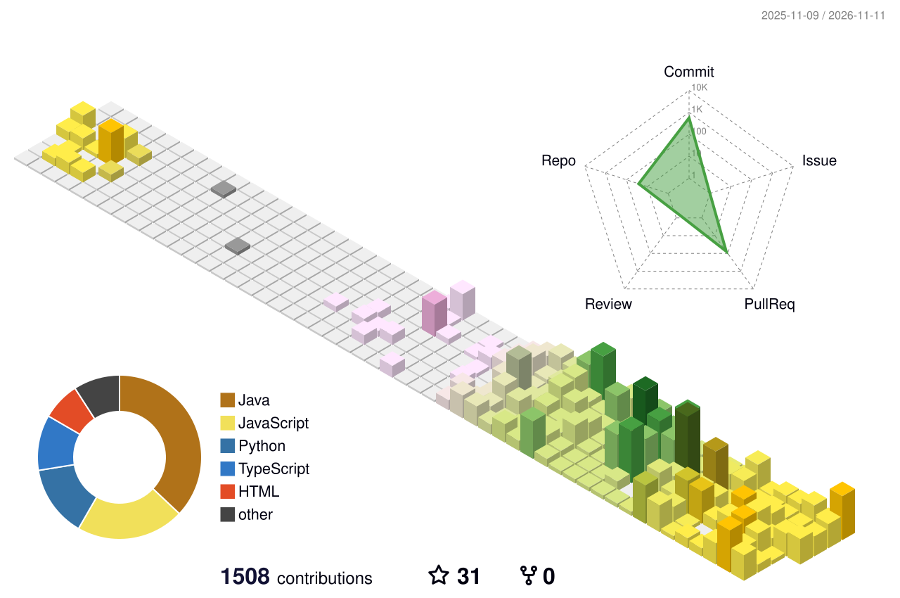

<!-- ══════════════════════════════════════════════════════════════════════
     armanxploits // bento edition
     Tiles live in assets/bento/ and are generated by scripts/build_bento_assets.py.
     Each tile adapts to light and dark mode on its own. The 3D contribution
     graph and snake are rebuilt every 12h by .github/workflows/main.yml
     ══════════════════════════════════════════════════════════════════════ -->

  

  <a href="https://www.arman-portfolio.online/"><b>Portfolio</b></a> &nbsp;·&nbsp;
  <a href="https://fsociety-web.vercel.app"><b>Security portfolio</b></a> &nbsp;·&nbsp;
  <a href="#selected-work"><b>Work</b></a> &nbsp;·&nbsp;
  <a href="#journey"><b>Journey</b></a> &nbsp;·&nbsp;
  <a href="#activity"><b>Activity</b></a>

   

    

  

   
   source: <a href="https://github.com/arman080325/Network-packet-analyzer">Network-packet-analyzer</a> &nbsp;·&nbsp; <a href="https://github.com/arman080325/fsociety-web">fsociety-web</a>

   
   source: <a href="https://github.com/arman080325/Banking-Management-System-Java">Banking-Management-System-Java</a> &nbsp;·&nbsp; <a href="https://github.com/arman080325/Student-Management-System-Java-Springboot">Student-Management-System-Java-Springboot</a>

   
   source: <a href="https://github.com/arman080325/SnapURL-Project">SnapURL-Project</a> &nbsp;·&nbsp; <a href="https://github.com/arman080325/cineroulette">cineroulette</a>

   
   source: <a href="https://github.com/arman080325/GitAtlas-Project">GitAtlas-Project</a> &nbsp;·&nbsp; <a href="https://github.com/arman080325/GrabMedia-Project">GrabMedia-Project</a>

   
   source: <a href="https://github.com/arman080325/Disease-Prediction-Updated">Disease-Prediction-Updated</a> &nbsp;·&nbsp; <a href="https://github.com/arman080325/SiteShield-Web">SiteShield-Web</a>

  

<b>More about how I work</b>

 

| | |
|---|---|
| **Build** | Spring Boot, Node.js, FastAPI and React. Real auth, real databases, CI, and a public URL for everything I ship. |
| **Break** | Web AppSec and pentesting practice on PortSwigger Academy, TryHackMe and HackTheBox. Manual testing over automated scans. |
| **Study** | Memory forensics with Volatility3 (MemLabs). Case studies on WannaCry and the Pegasus Airlines AWS breach. |
| **Rules** | Written authorization before every test. Responsible disclosure, always. CTFs, home labs and authorized programs only. |

<picture>
  <source media="(prefers-color-scheme: dark)" srcset="https://raw.githubusercontent.com/arman080325/arman080325/output/profile-night-rainbow.svg">
  
</picture>

<picture>
  <source media="(prefers-color-scheme: dark)" srcset="https://github-readme-stats.vercel.app/api?username=arman080325&show_icons=true&include_all_commits=true&count_private=true&bg_color=111118&border_color=262633&border_radius=22&title_color=f5f5f7&icon_color=8b7bff&text_color=d6d6de&ring_color=ff6b9a">
  
</picture>
<picture>
  <source media="(prefers-color-scheme: dark)" srcset="https://github-readme-stats.vercel.app/api/top-langs/?username=arman080325&layout=compact&langs_count=8&bg_color=111118&border_color=262633&border_radius=22&title_color=f5f5f7&text_color=d6d6de">
  
</picture>

<picture>
  <source media="(prefers-color-scheme: dark)" srcset="https://github-readme-streak-stats.herokuapp.com?user=arman080325&background=111118&border=262633&border_radius=22&ring=8b7bff&fire=ff6b9a&currStreakNum=f5f5f7&sideNums=f5f5f7&currStreakLabel=8b7bff&sideLabels=9b9bab&dates=9b9bab&stroke=262633">
  
</picture>

<picture>
  <source media="(prefers-color-scheme: dark)" srcset="https://github-readme-activity-graph.vercel.app/graph?username=arman080325&bg_color=111118&color=9b9bab&line=8b7bff&point=ff6b9a&area=true&area_color=8b7bff&hide_border=false&radius=22&custom_title=Contributions%20%C2%B7%20last%2031%20days">
  
</picture>

<picture>
  <source media="(prefers-color-scheme: dark)" srcset="https://raw.githubusercontent.com/arman080325/arman080325/output/github-contribution-grid-snake-dark.svg">
  
</picture>

  

  <a href="https://www.arman-portfolio.online/">Portfolio</a> &nbsp;·&nbsp;
  <a href="https://fsociety-web.vercel.app">fsociety-web</a> &nbsp;·&nbsp;
  <a href="https://tryhackme.com">TryHackMe</a> &nbsp;·&nbsp;
  <a href="https://www.hackthebox.com">HackTheBox</a> &nbsp;·&nbsp;
  <a href="https://portswigger.net/web-security">PortSwigger Academy</a>
    
  

