<!-- ══════════════════════════════════════════════════════════════════════
     armanxploits // readme-03-blueprint
     A profile drawn as an engineering drawing set:
       white ink  = the builder (drawings and schematics)
       red markup = the breaker (security review notes)
     Drawings:      assets/blueprint/  (scripts/build_blueprint_assets.py)
     Live sheets:   output-blueprint branch, redrawn every 12h from GitHub data
                    (scripts/build_blueprint_stats.py, .github/workflows/main.yml)
     ══════════════════════════════════════════════════════════════════════ -->

  <a href="https://www.arman-portfolio.online/"></a>

  <b>SHEET INDEX</b> 
  <a href="#bill-of-materials"><code>02 · BILL OF MATERIALS</code></a> &nbsp;
  <a href="#exploded-view"><code>03 · EXPLODED VIEW</code></a> &nbsp;
  <a href="#system-schematics"><code>04 · SCHEMATICS</code></a> &nbsp;
  <a href="#revision-history"><code>05 · REVISIONS</code></a> &nbsp;
  <a href="#field-measurements"><code>06 · MEASUREMENTS</code></a>


  


  


  <a href="https://network-packet-analyzer-tan.vercel.app"></a> <a href="https://fsociety-web.vercel.app"></a>
   source: <a href="https://github.com/arman080325/Network-packet-analyzer"><code>Network-packet-analyzer</code></a> &nbsp;·&nbsp; <a href="https://github.com/arman080325/fsociety-web"><code>fsociety-web</code></a>

  <a href="https://banking-management-system-java.onrender.com"></a> <a href="https://student-management-system-java-springboot.onrender.com"></a>
   source: <a href="https://github.com/arman080325/Banking-Management-System-Java"><code>Banking-Management-System-Java</code></a> &nbsp;·&nbsp; <a href="https://github.com/arman080325/Student-Management-System-Java-Springboot"><code>Student-Management-System-Java-Springboot</code></a>

  <a href="https://snapurl-project.vercel.app"></a> <a href="https://cineroulette-web-nu.vercel.app"></a>
   source: <a href="https://github.com/arman080325/SnapURL-Project"><code>SnapURL-Project</code></a> &nbsp;·&nbsp; <a href="https://github.com/arman080325/cineroulette"><code>cineroulette</code></a>

  <a href="https://git-atlas-project.vercel.app"></a> <a href="https://arman080325.github.io/GrabMedia-Project/"></a>
   source: <a href="https://github.com/arman080325/GitAtlas-Project"><code>GitAtlas-Project</code></a> &nbsp;·&nbsp; <a href="https://github.com/arman080325/GrabMedia-Project"><code>GrabMedia-Project</code></a>

  <a href="https://disease-prediction-updated.vercel.app"></a> <a href="https://github.com/arman080325/SiteShield-Web"></a>
   source: <a href="https://github.com/arman080325/Disease-Prediction-Updated"><code>Disease-Prediction-Updated</code></a> &nbsp;·&nbsp; <a href="https://github.com/arman080325/SiteShield-Web"><code>SiteShield-Web</code></a>


  


   

  

  

  <a href="https://www.arman-portfolio.online/"></a>

  <a href="https://www.arman-portfolio.online/">Portfolio</a> &nbsp;·&nbsp;
  <a href="https://fsociety-web.vercel.app">fsociety-web</a> &nbsp;·&nbsp;
  <a href="https://tryhackme.com">TryHackMe</a> &nbsp;·&nbsp;
  <a href="https://www.hackthebox.com">HackTheBox</a> &nbsp;·&nbsp;
  <a href="https://portswigger.net/web-security">PortSwigger Academy</a>
    
  

