<!-- Visuals in assets/ui are generated by scripts/build_assets.py (light + dark variants).
     The 3D contribution graph and snake are rebuilt every 12h by .github/workflows/main.yml -->

<a href="https://www.arman-portfolio.online/">
<picture>
  <source media="(prefers-color-scheme: dark)" srcset="assets/ui/hero-dark.svg">
  
</picture>
</a>

<picture>
  <source media="(prefers-color-scheme: dark)" srcset="assets/ui/h-about-dark.svg">
  
</picture>

I'm a **B.Tech CSE student ('23–'27)** at Silicon Institute of Technology, Bhubaneswar, currently working as a **Cybersecurity Intern** focused on penetration testing and web application security.

I work on both sides of the stack. I design and ship full-stack products with **Spring Boot, Node.js, FastAPI and React**, then review them the way an attacker would and harden what I find. Most of my projects start as a classroom app, a console program or a weekend idea, and end up as deployed services with real auth, real databases, CI and a public URL.

- 🔭 &nbsp;**Building:** [SiteShield](https://github.com/arman080325/SiteShield-Web), a SaaS that grades and monitors website security posture
- 🧪 &nbsp;**Practising:** PortSwigger Web Security Academy, TryHackMe and HackTheBox
- 🔎 &nbsp;**Studying:** memory forensics with Volatility3 (MemLabs)
- 🌐 &nbsp;**Portfolio:** [arman-portfolio.online](https://www.arman-portfolio.online/) &nbsp;·&nbsp; **Security portfolio:** [fsociety-web](https://fsociety-web.vercel.app)

<picture>
  <source media="(prefers-color-scheme: dark)" srcset="assets/ui/h-projects-dark.svg">
  
</picture>

<a href="https://network-packet-analyzer-tan.vercel.app"><picture>
  <source media="(prefers-color-scheme: dark)" srcset="assets/ui/card-netscope-dark.svg">
  
</picture></a>
<a href="https://fsociety-web.vercel.app"><picture>
  <source media="(prefers-color-scheme: dark)" srcset="assets/ui/card-fsociety-dark.svg">
  
</picture></a>
 source: <a href="https://github.com/arman080325/Network-packet-analyzer"><code>Network-packet-analyzer</code></a> &nbsp;·&nbsp; <a href="https://github.com/arman080325/fsociety-web"><code>fsociety-web</code></a>

<a href="https://banking-management-system-java.onrender.com"><picture>
  <source media="(prefers-color-scheme: dark)" srcset="assets/ui/card-industrust-dark.svg">
  
</picture></a>
<a href="https://student-management-system-java-springboot.onrender.com"><picture>
  <source media="(prefers-color-scheme: dark)" srcset="assets/ui/card-sms-dark.svg">
  
</picture></a>
 source: <a href="https://github.com/arman080325/Banking-Management-System-Java"><code>Banking-Management-System-Java</code></a> &nbsp;·&nbsp; <a href="https://github.com/arman080325/Student-Management-System-Java-Springboot"><code>Student-Management-System-Java-Springboot</code></a>

<a href="https://snapurl-project.vercel.app"><picture>
  <source media="(prefers-color-scheme: dark)" srcset="assets/ui/card-snapurl-dark.svg">
  
</picture></a>
<a href="https://cineroulette-web-nu.vercel.app"><picture>
  <source media="(prefers-color-scheme: dark)" srcset="assets/ui/card-cineroulette-dark.svg">
  
</picture></a>
 source: <a href="https://github.com/arman080325/SnapURL-Project"><code>SnapURL-Project</code></a> &nbsp;·&nbsp; <a href="https://github.com/arman080325/cineroulette"><code>cineroulette</code></a>

<a href="https://git-atlas-project.vercel.app"><picture>
  <source media="(prefers-color-scheme: dark)" srcset="assets/ui/card-gitatlas-dark.svg">
  
</picture></a>
<a href="https://arman080325.github.io/GrabMedia-Project/"><picture>
  <source media="(prefers-color-scheme: dark)" srcset="assets/ui/card-grabmedia-dark.svg">
  
</picture></a>
 source: <a href="https://github.com/arman080325/GitAtlas-Project"><code>GitAtlas-Project</code></a> &nbsp;·&nbsp; <a href="https://github.com/arman080325/GrabMedia-Project"><code>GrabMedia-Project</code></a>

<a href="https://disease-prediction-updated.vercel.app"><picture>
  <source media="(prefers-color-scheme: dark)" srcset="assets/ui/card-disease-dark.svg">
  
</picture></a>
<a href="https://github.com/arman080325/SiteShield-Web"><picture>
  <source media="(prefers-color-scheme: dark)" srcset="assets/ui/card-siteshield-dark.svg">
  
</picture></a>
 source: <a href="https://github.com/arman080325/Disease-Prediction-Updated"><code>Disease-Prediction-Updated</code></a> &nbsp;·&nbsp; <a href="https://github.com/arman080325/SiteShield-Web"><code>SiteShield-Web</code></a>

<picture>
  <source media="(prefers-color-scheme: dark)" srcset="assets/ui/h-stack-dark.svg">
  
</picture>

<table>
<tr>
<td width="160"><b>Languages</b></td>
<td>
<picture>
  <source media="(prefers-color-scheme: dark)" srcset="https://skillicons.dev/icons?i=java,py,ts,js,php,html,css&theme=dark">
  
</picture>
</td>
</tr>
<tr>
<td><b>Frameworks</b></td>
<td>
<picture>
  <source media="(prefers-color-scheme: dark)" srcset="https://skillicons.dev/icons?i=spring,fastapi,nodejs,express,nestjs,nextjs,react,tailwind&theme=dark">
  
</picture>
</td>
</tr>
<tr>
<td><b>Data &amp; DevOps</b></td>
<td>
<picture>
  <source media="(prefers-color-scheme: dark)" srcset="https://skillicons.dev/icons?i=postgres,mysql,mongodb,redis,prisma,docker,githubactions,vercel,git,linux&theme=dark">
  
</picture>
</td>
</tr>
<tr>
<td><b>Security</b></td>
<td>
<code>Kali Linux</code> <code>Burp Suite</code> <code>Nmap</code> <code>Wireshark</code> <code>Metasploit</code> <code>Hashcat</code> <code>Volatility3</code> <code>Ghidra</code> <code>OWASP Top 10</code>
</td>
</tr>
</table>

<picture>
  <source media="(prefers-color-scheme: dark)" srcset="assets/ui/h-activity-dark.svg">
  
</picture>

<picture>
  <source media="(prefers-color-scheme: dark)" srcset="https://raw.githubusercontent.com/arman080325/arman080325/output/profile-night-view.svg">
  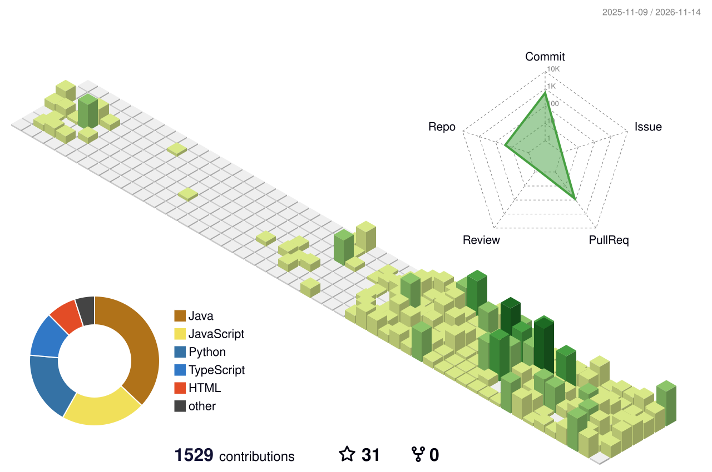
</picture>

 

<picture>
  <source media="(prefers-color-scheme: dark)" srcset="https://github-readme-stats.vercel.app/api?username=arman080325&show_icons=true&include_all_commits=true&count_private=true&bg_color=161b22&border_color=30363d&border_radius=12&title_color=e6edf3&icon_color=3fb950&text_color=c9d1d9&ring_color=3fb950">
  
</picture>
<picture>
  <source media="(prefers-color-scheme: dark)" srcset="https://github-readme-stats.vercel.app/api/top-langs/?username=arman080325&layout=compact&langs_count=8&bg_color=161b22&border_color=30363d&border_radius=12&title_color=e6edf3&text_color=c9d1d9">
  
</picture>

<picture>
  <source media="(prefers-color-scheme: dark)" srcset="https://github-readme-streak-stats.herokuapp.com?user=arman080325&background=161b22&border=30363d&border_radius=12&ring=3fb950&fire=3fb950&currStreakNum=e6edf3&sideNums=e6edf3&currStreakLabel=3fb950&sideLabels=8b949e&dates=8b949e&stroke=30363d">
  
</picture>

<picture>
  <source media="(prefers-color-scheme: dark)" srcset="https://github-readme-activity-graph.vercel.app/graph?username=arman080325&bg_color=161b22&color=8b949e&line=3fb950&point=e6edf3&area=true&area_color=3fb950&hide_border=false&radius=12&custom_title=Contributions%20in%20the%20last%2031%20days">
  
</picture>

<picture>
  <source media="(prefers-color-scheme: dark)" srcset="https://raw.githubusercontent.com/arman080325/arman080325/output/github-contribution-grid-snake-dark.svg">
  
</picture>

<picture>
  <source media="(prefers-color-scheme: dark)" srcset="assets/ui/h-connect-dark.svg">
  
</picture>

[**Portfolio**](https://www.arman-portfolio.online/) &nbsp;·&nbsp; [**Security portfolio**](https://fsociety-web.vercel.app) &nbsp;·&nbsp; [**TryHackMe**](https://tryhackme.com) &nbsp;·&nbsp; [**HackTheBox**](https://www.hackthebox.com) &nbsp;·&nbsp; [**PortSwigger Academy**](https://portswigger.net/web-security)

All security work is done in CTFs, personal labs or authorized programs, with responsible disclosure.

  

<picture>
  <source media="(prefers-color-scheme: dark)" srcset="assets/ui/footer-dark.svg">
  
</picture>

