<!-- ══════════════════════════════════════════════════════════════════════
     armanxploits // terminal edition
     Animated components live in assets/terminal/ and are generated by
     scripts/build_terminal_assets.py. The 3D contribution graph and the
     snake are rebuilt every 12h by .github/workflows/main.yml
     ══════════════════════════════════════════════════════════════════════ -->

<div align="center">

[](https://www.arman-portfolio.online/)

<a href="https://www.arman-portfolio.online/">
  
</a>

<a href="#about">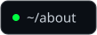</a>
<a href="#projects">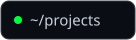</a>
<a href="#stack">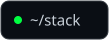</a>
<a href="#activity">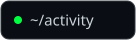</a>
<a href="#contact">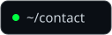</a>

<br><br>


</div>

<!-- ════════════════════════════  ABOUT / DUAL IDENTITY  ════════════════════════════ -->

<a name="about"></a>



<table>
<tr>
<td width="50%" valign="top">

### 🧩 `[ BRANCH: main ]`
#### The Builder

```js
const developer = {
  role   : "Full-Stack Web Developer",
  builds : ["responsive UIs", "REST APIs", "clean components"],
  craft  : "Spring Boot · Node · React · FastAPI",
  values : ["readable code", "fast load times", "security by design"],
  status : "SHIPPING 🚀",
};
```

> Design it. Build it. Make it *fast* and *hard to break.*

</td>
<td width="50%" valign="top">

### 🛡️ `[ BRANCH: redteam ]`
#### The Breaker

```js
const hacker = {
  role   : "Ethical Hacker / Security Researcher",
  hunts  : ["web vulns", "misconfigs", "weak auth"],
  craft  : "manual testing > automated scans",
  values : ["responsible disclosure", "scope respect", "ethics"],
  status : "HUNTING 🎯",
};
```

> Assess it. Report it. *Then help fix it.*

</td>
</tr>
</table>



<!-- ════════════════════════════  PROJECTS  ════════════════════════════ -->

<a name="projects"></a>


<p align="center"><sub><code>// every card is a live deployment: click to open it</code></sub></p>

<p align="center">
  <a href="https://network-packet-analyzer-tan.vercel.app"></a>
  <a href="https://fsociety-web.vercel.app"></a>
  <br><sub>source → <a href="https://github.com/arman080325/Network-packet-analyzer"><code>Network-packet-analyzer</code></a> · <a href="https://github.com/arman080325/fsociety-web"><code>fsociety-web</code></a></sub>
</p>

<p align="center">
  <a href="https://banking-management-system-java.onrender.com"></a>
  <a href="https://student-management-system-java-springboot.onrender.com"></a>
  <br><sub>source → <a href="https://github.com/arman080325/Banking-Management-System-Java"><code>Banking-Management-System-Java</code></a> · <a href="https://github.com/arman080325/Student-Management-System-Java-Springboot"><code>Student-Management-System-Java-Springboot</code></a></sub>
</p>

<p align="center">
  <a href="https://snapurl-project.vercel.app"></a>
  <a href="https://cineroulette-web-nu.vercel.app"></a>
  <br><sub>source → <a href="https://github.com/arman080325/SnapURL-Project"><code>SnapURL-Project</code></a> · <a href="https://github.com/arman080325/cineroulette"><code>cineroulette</code></a></sub>
</p>

<p align="center">
  <a href="https://git-atlas-project.vercel.app"></a>
  <a href="https://arman080325.github.io/GrabMedia-Project/"></a>
  <br><sub>source → <a href="https://github.com/arman080325/GitAtlas-Project"><code>GitAtlas-Project</code></a> · <a href="https://github.com/arman080325/GrabMedia-Project"><code>GrabMedia-Project</code></a></sub>
</p>

<p align="center">
  <a href="https://disease-prediction-updated.vercel.app"></a>
  <a href="https://github.com/arman080325/SiteShield-Web"></a>
  <br><sub>source → <a href="https://github.com/arman080325/Disease-Prediction-Updated"><code>Disease-Prediction-Updated</code></a> · <a href="https://github.com/arman080325/SiteShield-Web"><code>SiteShield-Web</code></a></sub>
</p>



<!-- ════════════════════════════  STACK  ════════════════════════════ -->

<a name="stack"></a>


<table>
<tr>
<td width="50%" valign="top" align="center">

#### 🧩 DEVELOPMENT


</td>
<td width="50%" valign="top" align="center">

#### 🗄️ DATA · DEVOPS


#### 🛡️ SECURITY


</td>
</tr>
</table>

<div align="center">

<sub><code>~/case-studies</code></sub><br>


</div>



<!-- ════════════════════════════  ACTIVITY  ════════════════════════════ -->

<a name="activity"></a>


<div align="center">

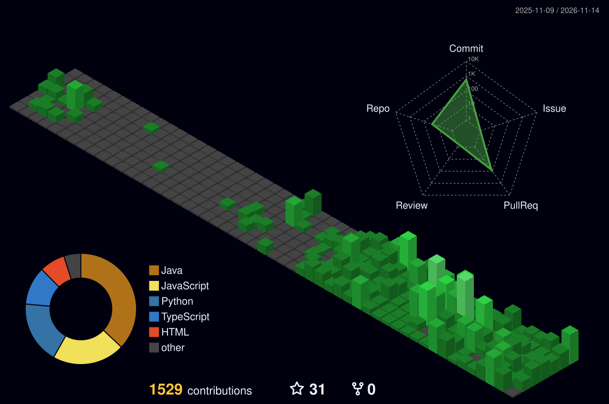


</div>

<!-- ════════════════════════════  CONTACT  ════════════════════════════ -->

<a name="contact"></a>


<div align="center">

<a href="https://www.arman-portfolio.online/"></a>
<a href="https://fsociety-web.vercel.app"></a>
<a href="https://github.com/arman080325"></a>
<a href="https://tryhackme.com"></a>
<a href="https://www.hackthebox.com"></a>
<a href="https://portswigger.net/web-security"></a>

<br><br>


<sub>two sides · one mission · crafted in the terminal, fueled by curiosity</sub>

</div>
