<!--  ░▒▓  armanxploits // profile  ▓▒░
      All art in assets/neon/ is generated by scripts/build_assets.py  -->

<div align="center">

<a href="https://www.arman-portfolio.online/">
  
</a>

<br>

<a href="https://www.arman-portfolio.online/"></a>
<a href="https://fsociety-web.vercel.app"></a>


</div>

<!-- ═══════════════════════════════ 0x01 ═══════════════════════════════ -->


<div align="center">
  
  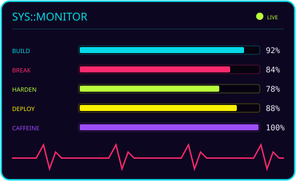
</div>

<br>

> **I build the web by day and break it by night, then patch every hole I find.**
> I take classroom and console projects and turn them into deployed products with real auth, real databases, CI and a public URL. Then I test them myself.
> Currently a **Cybersecurity Intern** working on pentesting and web AppSec while finishing **B.Tech CSE ('27)** at Silicon Institute of Technology, Bhubaneswar.

<!-- ═══════════════════════════════ 0x02 ═══════════════════════════════ -->


<p align="center"><sub><code>[ click any card to launch the live app ]</code></sub></p>

<p align="center">
  <a href="https://network-packet-analyzer-tan.vercel.app">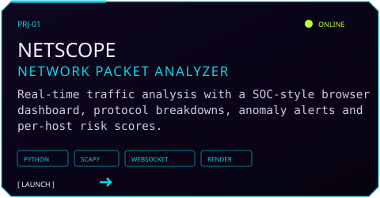</a>
  <a href="https://fsociety-web.vercel.app">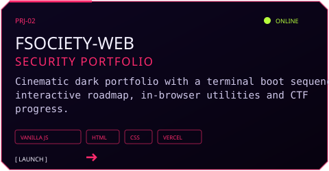</a>
  <br><sub>⌁ source → <a href="https://github.com/arman080325/Network-packet-analyzer">Network-packet-analyzer</a> · <a href="https://github.com/arman080325/fsociety-web">fsociety-web</a></sub>
</p>

<p align="center">
  <a href="https://banking-management-system-java.onrender.com">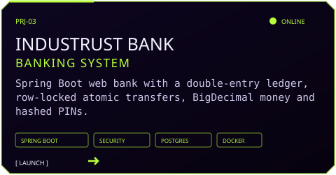</a>
  <a href="https://student-management-system-java-springboot.onrender.com">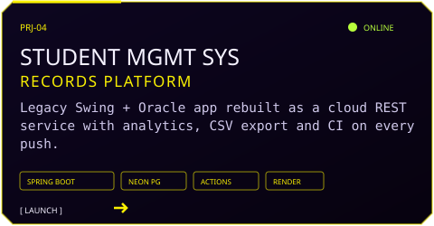</a>
  <br><sub>⌁ source → <a href="https://github.com/arman080325/Banking-Management-System-Java">Banking-Management-System-Java</a> · <a href="https://github.com/arman080325/Student-Management-System-Java-Springboot">Student-Management-System-Java-Springboot</a></sub>
</p>

<p align="center">
  <a href="https://snapurl-project.vercel.app">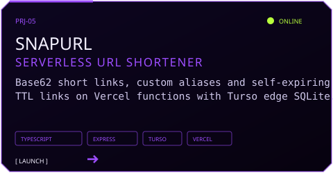</a>
  <a href="https://cineroulette-web-nu.vercel.app">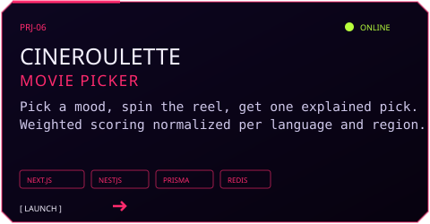</a>
  <br><sub>⌁ source → <a href="https://github.com/arman080325/SnapURL-Project">SnapURL-Project</a> · <a href="https://github.com/arman080325/cineroulette">cineroulette</a></sub>
</p>

<p align="center">
  <a href="https://git-atlas-project.vercel.app">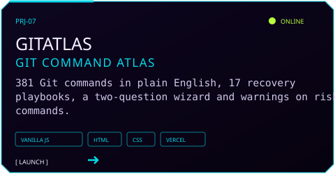</a>
  <a href="https://arman080325.github.io/GrabMedia-Project/">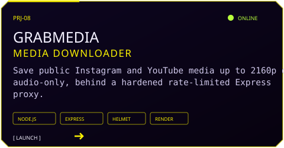</a>
  <br><sub>⌁ source → <a href="https://github.com/arman080325/GitAtlas-Project">GitAtlas-Project</a> · <a href="https://github.com/arman080325/GrabMedia-Project">GrabMedia-Project</a></sub>
</p>

<p align="center">
  <a href="https://disease-prediction-updated.vercel.app">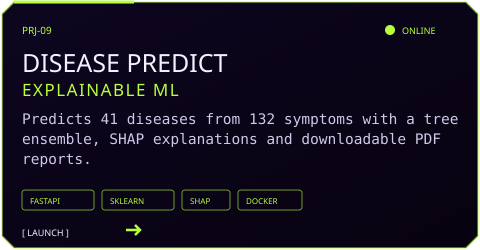</a>
  <a href="https://github.com/arman080325/SiteShield-Web">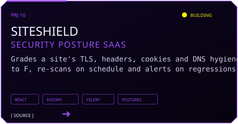</a>
  <br><sub>⌁ source → <a href="https://github.com/arman080325/Disease-Prediction-Updated">Disease-Prediction-Updated</a> · <a href="https://github.com/arman080325/SiteShield-Web">SiteShield-Web</a></sub>
</p>

<!-- ═══════════════════════════════ 0x03 ═══════════════════════════════ -->


<div align="center">
  
  <br><br>
  
</div>

<!-- ═══════════════════════════════ 0x04 ═══════════════════════════════ -->


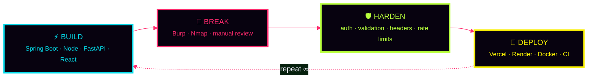

<details>
<summary><b><code>🔒 ./decrypt operator.log</code></b>&nbsp; <sub>(click to expand)</sub></summary>

<br>

```diff
@@ TRAINING GROUNDS @@
+ PortSwigger Web Security Academy
+ TryHackMe  ·  HackTheBox
+ XSS Game ............................ Level 6 cleared
~ MemLabs Lab 6 (Volatility3) ......... in progress

@@ CASE STUDIES @@
+ WannaCry ransomware breakdown
+ Pegasus Airlines AWS breach analysis
+ Ethical Hacking Notes ............... public knowledge base

@@ RIG @@
+ ASUS TUF F16 · RTX 3050 · Kali ⇄ Windows 11
+ zsh + Powerlevel10k · VS Code · Obsidian vault

@@ RULES OF ENGAGEMENT @@
+ Written authorization before every test
+ Responsible disclosure, always
- Out of scope? Not touching it.
```

</details>

<!-- ═══════════════════════════════ 0x05 ═══════════════════════════════ -->


<div align="center">


</div>

<!-- ═══════════════════════════════ 0x06 ═══════════════════════════════ -->


<div align="center">

<a href="https://www.arman-portfolio.online/"></a>
<a href="https://github.com/arman080325"></a>
<a href="https://tryhackme.com"></a>
<a href="https://www.hackthebox.com"></a>
<a href="https://portswigger.net/web-security"></a>

<br><br>


</div>
